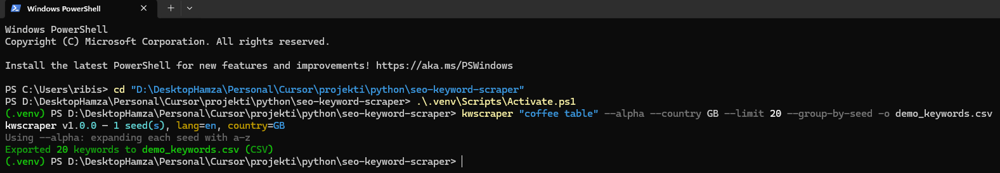
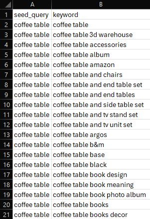

# SEO Keyword Scraper


A CLI tool that fetches Google autocomplete keyword suggestions and exports them to CSV or JSON. Supports single-query mode and multi-seed file mode, with language/region, rate limiting, and filtering options.

**Requirements:** Python 3.11+

## 🚀 Quick Start

**Using the package as a module (no install):**

```bash
python -m kwscraper "coffee table" --alpha -o keywords.csv
```

**Using the console command (after install):**

```bash
pip install -e .
kwscraper "coffee table" --alpha -o keywords.csv
```

Output is written to `keywords.csv` (or the path you pass to `-o`). After `pip install -e .`, you can use either `kwscraper` or `python -m kwscraper`. See [Output format](#output-format) and [Options](#options) below.

### Example output (CSV)

```csv
seed_query,keyword
coffee table,coffee table ideas
coffee table,coffee table books
coffee table,coffee table decor
coffee table,coffee table with storage
```

## How to run

From the project root (Windows PowerShell):

```powershell
python -m venv .venv
.\.venv\Scripts\Activate.ps1
pip install -r requirements.txt
pip install -e .
kwscraper "your query" --alpha -o keywords.csv
```

On macOS/Linux, activate the venv with `source .venv/bin/activate` instead of the second line. You can also run `python -m kwscraper "your query" --alpha -o keywords.csv` without installing.

## Installation

```bash
cd seo-keyword-scraper
pip install -r requirements.txt
pip install -e .   # optional: enables the kwscraper command
```

## Usage

- **Single-query mode:** pass one seed as the positional argument.
- **File mode:** pass `--file <path>` with a file that has one seed query per line (empty lines and lines starting with `#` are ignored).
- You can combine both: seeds from the file plus one positional query. All seeds are processed and results are combined; each row in the output includes which seed produced that keyword.

```bash
python -m kwscraper "your search query" [options]
python -m kwscraper --file seeds.txt [options]
python -m kwscraper --file seeds.txt "extra seed" [options]
```

### Output format

- **CSV** (default): columns `seed_query`, `keyword` — one row per keyword, so you can see which seed produced each suggestion.
- **JSON:** `{ "meta": { ... }, "results": [ { "seed_query": "...", "keyword": "..." }, ... ] }`. Use `--format json` or `-o out.json` (or legacy `--json`).

Format is inferred from the `--out` extension; if there is no extension, CSV is used. Use `--format csv` or `--format json` to override.

### Examples

**Single query, CSV (default):**

```bash
python -m kwscraper "coffee table"
```

**Single query with alpha expansion:**

```bash
python -m kwscraper "coffee table" --alpha --out keywords.csv
```

**Multi-seed from file — example seeds file (workplace safety):**

Create `seeds.txt`:

```text
# Example seeds (workplace safety)
lone worker safety app
man down alarm app
solo worker protection
panic button app
```

Then run:

```bash
python -m kwscraper --file seeds.txt --alpha --lang en --country GB --sleep 0.2 --format csv -o out.csv
```

**JSON output with limit and filters:**

```bash
python -m kwscraper --file seeds.txt --alpha --lang en --country GB --sleep 0.2 -o out.json --format json --limit 500 --min-len 5 --exclude "\bapp\b"
```

**Single query, JSON:**

```bash
kwscraper "coffee table" --alpha -o keywords.json
# or (legacy)
kwscraper "coffee table" --alpha --json -o keywords.json
```

**Preserve collection order (no alphabetical sort):**

```bash
kwscraper "coffee table" --alpha --no-sort -o keywords.csv
```

**Group output by seed (JSON):**

```bash
kwscraper --file seeds.txt --alpha --group-by-seed -o out.json --format json
```

With `--group-by-seed`, CSV still has columns `seed_query`, `keyword` but rows are grouped by seed; JSON uses a `groups` object: `{ "meta": {...}, "groups": { "seed1": ["kw1", "kw2", ...], "seed2": [...] } }`.

### Options

| Option | Description |
|--------|-------------|
| `query` | Single seed query (optional if `--file` is set). |
| `--file PATH` | File with one seed per line; empty and `#` lines ignored. |
| `--alpha` | Expand each seed with a–z for more suggestions. |
| `-o`, `--out FILE` | Output path (default: `keywords.csv`). |
| `--format {csv,json}` | Force format; overrides extension. |
| `--json` | (Legacy) Force JSON output. |
| `--lang CODE` | Language, `hl=` (default: `en`). |
| `--country CODE` | Country, `gl=` (default: `GB`). |
| `--sleep SECS` | Delay between requests in seconds (default: 0.2). |
| `--timeout SECS` | Request timeout (default: 10). |
| `--retries N` | Retries per request (default: 2). |
| `--limit N` | Max keywords in output (0 = no limit). |
| `--min-len N` | Drop keywords shorter than N characters. |
| `--exclude REGEX` | Exclude keywords matching regex (case-insensitive). |
| `--no-sort` | Preserve collection order; dedupe by first-seen, no alphabetical sort. |
| `--group-by-seed` | Group output by seed_query (CSV: rows grouped; JSON: `groups` object). |
| `-V`, `--version` | Show version and exit. |

## 📁 Project structure

| File | Role |
|------|------|
| `kwscraper/cli.py` | Argument parsing, seed loading, filtering, and orchestration; optional rich output. |
| `kwscraper/suggest.py` | HTTP calls to the Google suggest endpoint; language/country, retries, and alpha expansion. |
| `kwscraper/export.py` | Writes results to CSV (`seed_query`, `keyword`) or JSON (meta + results or `groups` when `--group-by-seed`). |

## FAQ

- **Rate limits / blocks:** The suggest endpoint can throttle or block if you send too many requests. Use `--sleep` (e.g. `0.2`–`0.5`) and avoid very large seed lists in one run. Prefer `--file` with a modest number of seeds and `--alpha` rather than hundreds of seeds.
- **Empty results:** If you get no keywords, check: (1) seed spelling and language/country (`--lang`, `--country`), (2) network/timeouts (`--timeout`, `--retries`), (3) filters (`--min-len`, `--exclude`) that might drop everything.

## 📸 Screenshots

### CLI Demo

Example run using the installed console command:



### Example CSV Output

Generated keyword suggestions exported into a CSV file:




## How it works

Suggestions are requested from:

`https://suggestqueries.google.com/complete/search?client=firefox&q=QUERY&hl=LANG&gl=COUNTRY`

With `--alpha`, the tool also requests suggestions for `query a`, `query b`, … `query z` per seed, then merges, filters (min length, exclude regex), deduplicates, sorts, and optionally limits before writing. Failed seeds are reported; the tool exits with a non-zero code only if every seed fails.

## License

MIT
